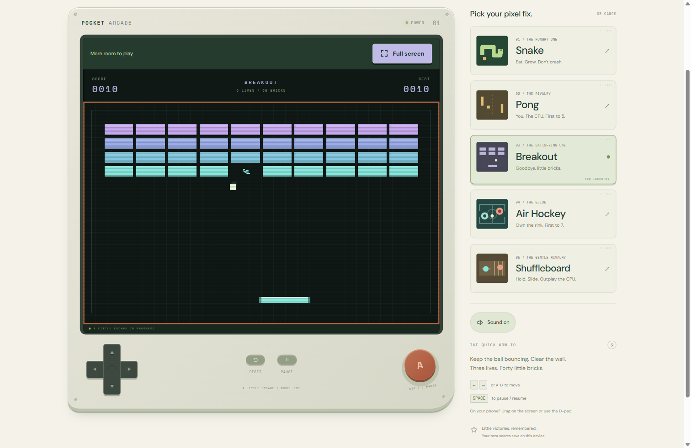
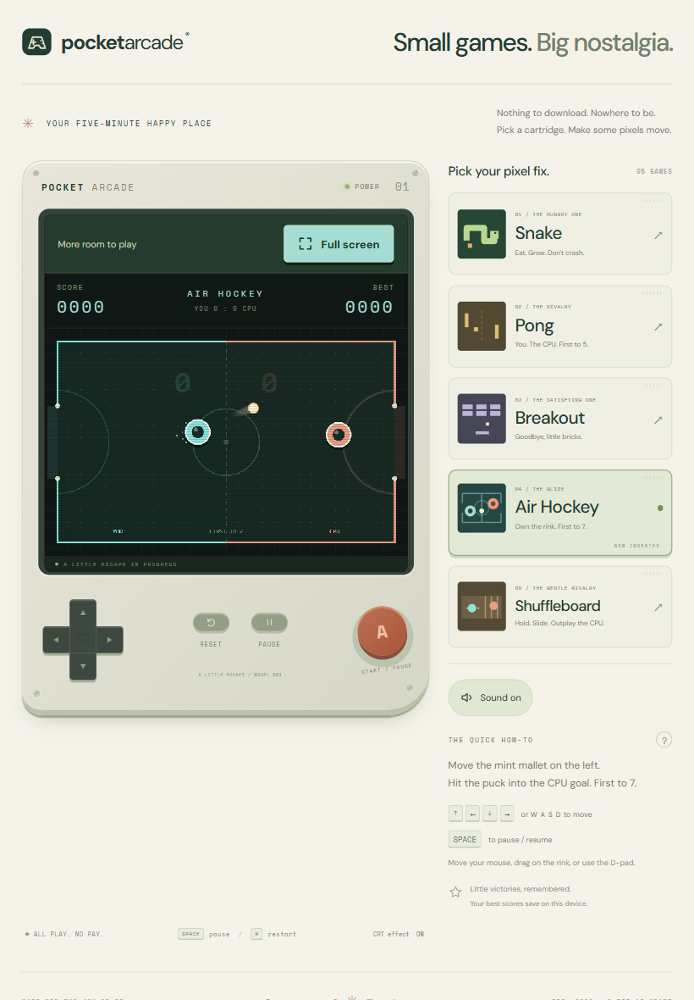
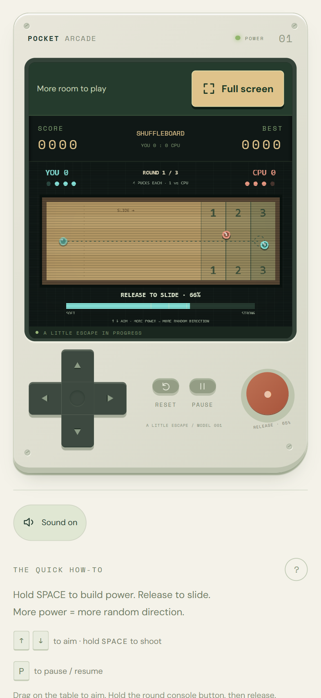

# Pocket Arcade

Play five games in a handheld-style browser console, then fork the React app and make a cartridge of your own. The same console works with a keyboard, a mouse, or a touchscreen. High scores and preferences are saved in your browser.

**[Play Pocket Arcade](https://pocket-arcade-alex-8bit.activegiant65.chatgpt.site)** · [Add a game with AI](#add-a-game-with-ai) · [Publish your own ChatGPT Site](#publish-your-own-chatgpt-site)

[](https://pocket-arcade-alex-8bit.activegiant65.chatgpt.site)

*Breakout on a MacBook-sized viewport (1512 × 982).*

## Pick a cartridge

| Game | How to play |
| --- | --- |
| Snake | Collect snacks and leave room to turn as your tail grows. Swipe or use the D-pad on a phone. |
| Pong | Defend the left side. Hit near the paddle’s edge to change the angle. First to five beats the CPU. |
| Breakout | Clear 40 bricks with three lives. Drag the paddle to line up the next bounce. |
| Air Hockey | Drag the mint mallet to bank the puck past the CPU. First to seven wins. |
| Shuffleboard | Aim, hold Space or the round console button, then release. Stronger shots travel farther and spread wider. Highest score after three rounds wins, with extra rounds for ties. |

Use the arrow keys or WASD to move, Enter to start, and P to pause. Select the **?** beside **The quick how-to** for the current cartridge’s controls.

<p align="center">
  <a href="docs/screenshots/tablet-air-hockey.png"></a>
  <a href="docs/screenshots/phone-shuffleboard.png"></a>
</p>

*Air Hockey at tablet size (820 × 1180) and Shuffleboard at phone size (393 × 852). All three screenshots show live gameplay in Chromium at the listed viewport sizes. The touch layouts use device emulation.*

## Run locally

Fork this repository on GitHub, clone your fork, and open its directory. With Node.js 22.12 or later, run the following commands and open the local URL Vite prints.

```sh
npm ci
npm run dev
```

The app needs no backend or API key. Run `npm test` for the game and React tests. Use `npm run build` to generate the static site in `build/`, then `npm run preview` to play that build locally.

## Add a game with AI

Open the fork in Codex or Claude Code. The repo includes skills for designing a cartridge and testing it against the shared console. Give the agent a rule it can test, how the player moves, and what ends a round. For example, try this prompt.

> Follow `skills/create-arcade-game/SKILL.md` to add Lantern Run. I steer a moth with the arrow keys or the touch D-pad. Light five lanterns in 30 seconds to win, earning ten points per lantern. Add a cartridge card, in-game help, and tests for scoring and timeout. Follow `skills/validate-arcade-build/SKILL.md` and open the game in a local preview.

See the [cartridge skill](skills/create-arcade-game/SKILL.md), [validation skill](skills/validate-arcade-build/SKILL.md), and [game engine contract](docs/maintainers.md#game-engine-contract) for the parts your new game plugs into.

## Publish your own ChatGPT Site

A personal edition gets its own URL and version history. A GitHub fork initially contains the original demo’s Site ID, so open your fork in Codex with Sites enabled and ask it to create a new destination. [Publishing skill](skills/publish-arcade-site/SKILL.md)

> @Sites Follow `skills/publish-arcade-site/SKILL.md`. Create a new Site I own called Lantern Arcade from this fork, including my new game. Use the new Site’s project ID, build and publish the `build/` directory, and give me the live URL and the checkout to use for future updates.

Open your new URL and review it. To invite players, open **Share** and choose **Anyone on the internet** if your account offers it. For later updates, use your edition’s checkout and Site ID. You can also start from the published games by asking Sites to remix the [live demo](https://pocket-arcade-alex-8bit.activegiant65.chatgpt.site).

**Hosting cost.** Running a personal copy locally is free. As of November 2026, ChatGPT Plus and Pro include Sites hosting at no additional charge within plan limits. Building and editing use your Codex allowance. Publishing requires an eligible ChatGPT plan. [OpenAI’s Sites and pricing guide](https://help.openai.com/en/articles/20001339-creating-and-using-chatgpt-sites)

## Contribute and license

New cartridges and improvements are welcome. Read the [contribution guide](CONTRIBUTING.md) and [contributor agreement](CLA.md) before opening a pull request. For project structure and coding conventions, see the [maintainer guide](docs/maintainers.md), [AGENTS.md](AGENTS.md), and [CLAUDE.md](CLAUDE.md).

Pocket Arcade is source-available for personal and other uses permitted by the [PolyForm Noncommercial License 1.0.0](LICENSE). Keep the license and [copyright notice](NOTICE) with redistributed copies. Third-party dependencies retain their own licenses. For commercial use, open a GitHub issue titled **Commercial licensing inquiry** with a brief, nonconfidential description and ask for a private channel to discuss terms.
